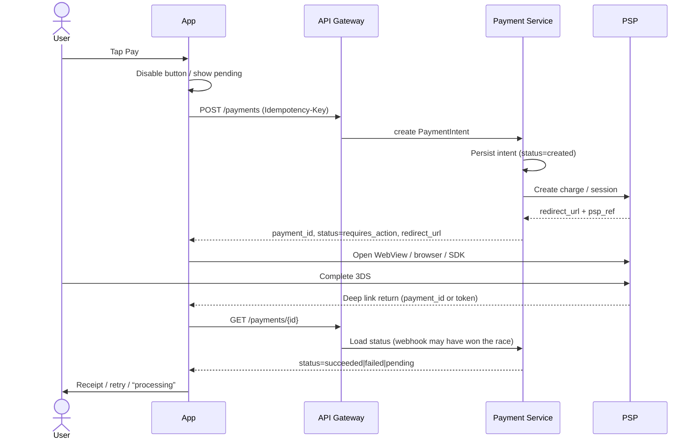

# Chapter 28 — Mobile Fintech System Design (Lite)

Fintech interviews for mobile engineers are not SRE interviews. Nobody expects you to size Kafka partitions from first principles. They *do* expect you to design the client half of money movement: clear APIs, honest pending states, idempotent Pay taps, and failure modes that do not double-charge or show a wrong balance.

This chapter is a **lite system-design track** for checkout, wallet, offline sync, and transaction feeds — scoped to what a senior mobile hire should own and explain in 35–45 minutes.

Companion outlines: [`solutions/ch28/README.md`](../../solutions/ch28/README.md)

---

## How to run a 35–45 minute design interview

Treat the clock like a product launch: clarify first, ship a thin vertical slice, then deepen failure and scale only where money is at risk.

| Minutes | Move | What interviewers listen for |
|---------|------|------------------------------|
| 0–5 | **Clarify** | Actors, success definition, money vs display, platforms, constraints (offline? 3DS?) |
| 5–12 | **API surface** | Endpoints, request/response shapes, auth, idempotency keys, status enums |
| 12–22 | **Data & client state** | Local models, cache vs source of truth, UI states (idle / loading / pending / settled / failed) |
| 22–32 | **Failure modes** | Timeouts, retries, double-tap, redirect loss, stale balance, conflicts |
| 32–40 | **Scale back** | Spike QPS, what the *client* does under load (coalesce, backoff), what you push to backend |
| 40–45 | **Recap** | Tradeoffs you chose; what you would do with another hour |

**Clarify checklist (say aloud):**

1. Is this **initiate payment** or **display money**? Different consistency rules.
2. Who is the **source of truth** — your backend ledger, a PSP, or both?
3. Does the user leave the app (WebView / browser / UPI intent)? How do they return?
4. What is “done” for the user — receipt on screen, push later, or poll until settled?
5. Latency budget and offline expectations.

**Scale-back rule:** Draw the happy path end-to-end first. Add queues, outbox, and multi-region only if the interviewer pulls you there. For mobile seats, depth on **idempotency + return deep link + pending UI** beats a half-drawn CDN map.

---

## Case A — Checkout / Pay button flow

### Goal

User taps Pay once (or twice — see Case A failure modes). Client obtains a chargeable session from your API, PSP completes auth (often 3DS / redirect), app resumes, and UI converges on **succeeded / failed / still pending** without inventing a second charge.

### Components (mobile-centric)

```text
App (Pay UI)
  → API Gateway (auth, rate limit)
    → Payment Service (order / payment intent, idempotency store)
      → PSP (card / UPI / wallet rails)
App ← deep link / intent / Universal Link on return
App → Payment Service (status poll or webhook-backed GET)
```

### Sequence (happy path with 3DS redirect)



### API sketch

```http
POST /v1/payments
Idempotency-Key: {client_generated_uuid}
Authorization: Bearer {access_token}
Content-Type: application/json

{
  "order_id": "ord_123",
  "amount": { "currency": "INR", "minor": 49900 },
  "method": "card",
  "return_url": "myapp://pay/return"
}
```

```json
{
  "payment_id": "pay_9f2",
  "status": "requires_action",
  "client_action": { "type": "redirect", "url": "https://psp.example/3ds/..." },
  "poll_after_ms": 1500
}
```

Statuses you should name in the interview: `created` → `requires_action` → `processing` → `succeeded` | `failed` | `cancelled`. Never collapse “processing” into “succeeded” on the client because the redirect returned.

### Idempotency

- Client generates an **Idempotency-Key** per logical user attempt (new key only on explicit Retry after terminal failure).
- Payment service stores `key → payment_id` (TTL hours/days). Replay returns the **same** payment.
- UI: first tap disables Pay; second tap while in-flight is a no-op (client-side). Server idempotency still required — process death mid-flight is real.

### Timeouts and retries

| Hop | Typical client stance |
|-----|------------------------|
| `POST /payments` | Short timeout (10–20s). On timeout: **do not** blindly POST again with a new key. GET by key/order or show “check status.” |
| Redirect / 3DS | User-controlled; treat as abandoned after N minutes with a clear “Resume / Check status” CTA. |
| `GET /payments/{id}` | Poll with backoff + cap; prefer push when available. |

**Retry rule for money:** retry **reads** freely; retry **writes** only with the same idempotency key or after a confirmed non-existence.

### Deep link return

- Register a claimed HTTPS app link / Universal Link / App Link, not only a custom scheme (custom schemes are spoofable).
- Return payload should be a **payment_id** (or opaque resume token), not “success=true.” The app always **re-fetches** server status.
- Handle: cold start from link, warm resume, user killing the browser mid-3DS, and duplicate link opens.

### Pending states on mobile

Show **Processing** with last-known facts (amount, method mask). Offer “Refresh status.” Do not flash success from WebView title hacks. If webhooks lag, pending is correct — lying is the bug.

---

## Step-up authentication (3DS, SCA, biometrics)

**Step-up** means re-proving the user before a high-risk action (Pay, change payout account, raise limits). It stacks on top of session login — not a replacement.

| Mechanism | Role on mobile | Interview note |
|-----------|----------------|----------------|
| **3DS / SCA redirect** | Card issuer challenge in WebView/browser/ SDK | User may leave app; **resume + server status** (Case A) |
| **Biometrics** (Face ID / fingerprint) | Local re-auth gate before calling Pay API | Unlocks app action; **does not** replace server idempotency |
| **Device PIN / passcode** | Fallback when biometrics fail | Same — UX gate only |
| **Passkeys / WebAuthn** | Passwordless login; emerging step-up | Store credentials in platform passkey store; still server session for money APIs |
| **OTP / SMS / TOTP** | Out-of-band proof | Never log OTP; rate-limit verify attempts server-side |

### Platform patterns (four languages — concept level)

**Android:** `BiometricPrompt` before `createPayment`; cancel → no API call. Keystore-backed keys for app unlock vs payment signing (signing is backend/PSP territory).

**iOS:** `LAContext.evaluatePolicy(.deviceOwnerAuthenticationWithBiometrics)` before Pay; fall back to passcode policy. Keychain for session refresh tokens — not for “proving charge” to the card network (that is 3DS).

**Flutter / RN:** Use platform channels / native modules to biometrics APIs; never store “biometric passed” as a permanent flag — re-prompt per sensitive action per product policy.

### Ordering in checkout (say aloud)

```text
Session valid?
  → Biometric / PIN step-up (client gate)
    → POST /payments with Idempotency-Key
      → requires_action? → 3DS / UPI / PSP SDK
        → GET status until terminal
```

**Common mistake:** Treating biometric success as payment success. Biometric only means “this user unlocked Pay on this device”; PSP still decides.

**Accessibility:** Offer non-biometric fallback where policy allows; announce pending/processing states to VoiceOver/TalkBack (“Payment processing, not yet confirmed”).

For India UPI app-switch specifics, see [Appendix E — UPI & India Rails](../appendices/E-upi-india-rails.md).

---

## Case B — Wallet balance + ledger on mobile

### Goal

Home shows balance; ledger lists entries. Numbers feel “live” but the system is **eventually consistent**. Interviewers want you to admit that and design the UX around it.

### Consistency model (say this)

- **Ledger / balance service** is source of truth.
- Client cache is a **projection** with a `as_of` / `updated_at` watermark.
- After a payment or refund, balance may lag; UI should prefer **honest freshness** over fake precision.

### Read paths

1. **Cold open:** show last cached balance immediately (stale-while-revalidate), kick network refresh.
2. **Pull-to-refresh:** force network; show spinner on the header, not a blank screen.
3. **Push / silent push:** “balance_changed” → coalesce refreshes (Chapter 23 single-flight).
4. **Foreground:** optional soft refresh if cache older than TTL (e.g. 30–60s for money UIs — product-specific).

### Stale-while-revalidate pattern

```text
render(cachedBalance, freshness=stale|fresh)
launch singleFlight("balance") {
  remote = GET /wallet
  if remote.updated_at >= cached.updated_at: commit
  else: ignore older response (out-of-order)
}
```

**Ledger list:** cursor pagination (`GET /ledger?cursor=`). Merge by `entry_id`; never append blindly. Mark refunds/reversals with stable ids so the row updates in place.

### What not to do

- Do not sum local pending drafts into “available” unless product explicitly defines **available vs pending**.
- Do not animate balance up on client optimism for refunds you have not confirmed.
- Do not treat push as authoritative without a fetch (push can be delayed, duplicated, or dropped).

---

## Case C — Offline-first expense list that syncs

### Goal

User logs expenses on a plane. Later, rows sync to server. **Money rows are not chat messages** — conflict policy matters.

### Local model

```text
ExpenseDraft {
  local_id, server_id?,
  amount_minor, currency, note, spent_at,
  updated_at_client, sync_state: pending|syncing|synced|conflict
}
```

Queue: durable outbox on disk (SQLite / Room / Core Data / Hive). Sync worker drains FIFO with backoff.

### Conflict strategies

| Strategy | Rule | Fit for money? |
|----------|------|----------------|
| **LWW (last-write-wins)** | Higher timestamp wins | Risky if clocks skew; OK for *notes*, dangerous for *amount* |
| **Server authority** | Server version wins; client must rebase | Default for balances, settlements, limits |
| **Field merge** | Note LWW, amount server-only | Common practical split |
| **Manual conflict UI** | Surface both versions | Rare; use for high-value edits |

**Interview answer:** “For amount and currency I use **server authority** with version tokens. For memo text I may LWW. I never invent a merged amount.”

### Sync protocol sketch

1. Client `POST /expenses` with `client_mutation_id` (idempotent create).
2. Server returns `server_id` + `version`.
3. Updates send `If-Match: version`. On 409, fetch server row, mark `conflict`, do not overwrite silently.
4. Deletes are soft-delete tombstones until acked.

### Mobile notes

- Bound the outbox; surface “N expenses waiting to sync.”
- Do not block UI on sync. Do block **submit payment** on unresolved conflicts for that wallet.
- Clock: prefer server `updated_at` for ordering after first sync; client clock only for local sort while offline.

---

## Case D — Notification + transaction feed fan-in

### Goal

Push says “₹500 received.” Feed must show the same txn once, ordered, with infinite scroll.

### Fan-in sources

```text
Push payload (txn_id, type, coarse fields)
  + Foreground poll / websocket
  + Pull-to-refresh
  → In-memory / DB feed keyed by txn_id
```

### Dedupe

- Primary key: **`txn_id`** (stable across push and REST).
- Upsert: if incoming `updated_at` is newer, replace row; else keep.
- Notification tray: use `txn_id` as notification tag/collapse key so OS replaces duplicates.

### Cursor pagination

```http
GET /v1/transactions?cursor=eyJvIjoxNzA...&limit=20
```

- Cursor is opaque; do not invent page numbers for mutating feeds.
- On refresh from top: reset to latest cursor head; merge by id into local store.
- Empty `next_cursor` ends the list; distinguish from network error.

### Client structure

`Map<txn_id, Txn>` + ordered list of ids (or SQL `ORDER BY booked_at DESC, txn_id DESC`). Push handler upserts map, rebinds list adapter/diffable datasource.

---

## Mobile-specific security & compliance (interview depth)

### Certificate pinning

**Pros:** Mitigates custom-CA MITM on compromised devices; raises bar for traffic interception.  
**Cons:** Pin rotation outages if you ship pins without backup; enterprise proxies break; harder debugging.

**Say in interview:** Pin leaf or intermediate with a **backup pin**; plan forced update path; know when *not* to pin (rapidly changing CDN edges). Many teams pin only to API hosts, not every third-party.

### Secure token storage

| Platform | Prefer | Avoid |
|----------|--------|-------|
| iOS | Keychain (`kSecAttrAccessibleAfterFirstUnlockThisDeviceOnly` as a common baseline — product-specific) | `UserDefaults`, plaintext files |
| Android | EncryptedSharedPreferences / Keystore-backed | Plain `SharedPreferences`, logging tokens |
| Cross-platform | OS-backed secure storage plugins | JS AsyncStorage for refresh tokens |

Access tokens: short-lived in memory when possible; refresh tokens in secure storage. Clear on logout. Never embed secrets in the binary.

### PCI scope (mobile)

- **Never store PAN / CVV** on device or in your logs.
- Prefer **PSP SDKs** / hosted fields so card data never touches your WebView bridge.
- If you must show a card, show **masked** PAN from server (`•••• 4242`).
- Screenshot / screen-recording: treat as data exfil for balances and card screens — use platform flags (`FLAG_SECURE`, `UITextField.isSecureTextEntry` where appropriate, screen-capture callbacks) on sensitive surfaces.

### Screenshot privacy for balances

Hide or mask balance when app backgrounds if product requires; block screen capture on wallet/card screens in high-threat markets. Document the tradeoff: accessibility and user screenshots of receipts may conflict — decide with product/compliance, do not invent policy mid-interview.

---

## Capacity back-of-envelope (light)

You are not sizing the data center; you are showing you understand **spikes**.

**Example:** Flash sale checkout.

- 200k users open app in 10 minutes → ~333 opens/s peak (rough).
- 5% hit Pay in the same window → ~17 Pay taps/s average; peak maybe 5–10× with herding → **~100–170 QPS** to `POST /payments`.
- Each Pay may cause 1 redirect + 2–5 status polls → **poll QPS** can dominate if you poll too aggressively.

**Client mitigations that score points:**

- Coalesce status polls per `payment_id`.
- Exponential backoff; stop when terminal.
- Disable Pay during in-flight; idempotency key on the wire.
- Degrade non-critical home widgets; keep checkout path prioritized.

Mention server autoscaling and rate limits only as assumptions — then return to client behavior.

---

## Common mistakes in fintech design interviews

1. Declaring success from the redirect URL query string.
2. New idempotency key on every network retry.
3. Optimistic balance updates without a reconciliation story.
4. LWW on expense amounts.
5. Page-number pagination on a live transaction feed.
6. Storing PAN “just for convenience.”
7. Designing Kafka before defining payment statuses.

---

## Self-Check

Use these closed-book. Answers: [Appendix D](../appendices/D-self-check-answer-key.md) (also in [`solutions/ch28`](../../solutions/ch28/README.md#self-check-answer-key)).

**28.1** Why must the app re-fetch payment status after a 3DS deep-link return instead of trusting `success=1` in the URL?

**28.2** What is the difference between disabling the Pay button and sending an Idempotency-Key?

**28.3** When is last-write-wins acceptable in an offline expense sync, and when is it not?

**28.4** How do you prevent the same transfer from appearing twice when both a push and a REST refresh arrive?

**28.5** Name one benefit and one operational risk of certificate pinning on a mobile payment API host.

**28.6** What does biometric unlock prove vs what does 3DS prove — and what should each **not** be treated as?

*(Answers: [Appendix D](../appendices/D-self-check-answer-key.md).)*

---

## Practice

Worked scored outlines:

→ **[`solutions/ch28/README.md`](../../solutions/ch28/README.md)**

1. **Design: UPI collect / intent return** — See [Appendix E](../appendices/E-upi-india-rails.md) + rubric in `solutions/ch28`.
2. **Design: In-app “request money” + settle later** — Requester creates a request; payer pays days later; both apps show timeline state. Cover notifications, feed dedupe, and balance freshness on both sides.

For each: 35-minute outline (clarify → API → data → failures → scale-back). Score yourself with the rubrics in `solutions/ch28`.

---

## What to remember

Fintech mobile is **state machines for money** plus **humble caching**. Idempotency and pending beats clever diagrams. Server is authority for balances and settlements; the client is a careful projector with secure storage, PSP SDKs for cards, and feeds keyed by stable ids. Next: [Chapter 29 — Behavioral & Product Sense](29-behavioral-product-fintech.md). Before you apply, see [Appendix F — Execution & Optional Polish](../appendices/F-execution-and-optional-polish.md).
